<div align="center">

  <!-- HERO BANNER -->
  <a href="https://portofolio-taqiy.vercel.app" target="_blank">
    
  </a>

  <!-- TYPING SVG -->
  <a href="https://portofolio-taqiy.vercel.app">
    
  </a>

  <br/>

  <!-- QUICK STATUS BADGES -->
  <p align="center">
    <a href="https://portofolio-taqiy.vercel.app">
      
    </a>
    <a href="https://www.linkedin.com/in/muhammad-irbah-taqiy-139615405">
      
    </a>
    <a href="mailto:irbahtaqiy@gmail.com">
      
    </a>
    
  </p>

</div>

---

### 🎨 The Designer Dossier

```figma
┌────────────────────────────────────────────────────────────────────────┐
│  Component: Designer_Profile [Taqiy]                                  │
├────────────────────────────────────────────────────────────────────────┤
│  • Role        : UI/UX & Product Interface Designer                   │
│  • Background  : Software Engineering (RPL)                           │
│  • Superpower  : Designing with code empathy (Figma ➔ Tailwind/React)  │
│  • Philosophy  : "1% Better Every Day" — Precision in every pixel      │
│  • Focus       : Design Systems, Micro-Interactions, Usability        │
└────────────────────────────────────────────────────────────────────────┘
```

> **"A great interface isn’t just seen — it’s felt."**  
> I am a UI/UX Designer based in Jakarta with a solid foundation in Software Engineering (Rekayasa Perangkat Lunak). Having both design intuition and coding literacy allows me to build design systems that are not only aesthetically engaging, but structurally sound, scalable, and effortless for developers to implement.

---

### 🛠️ Design System & Tech Stack

<div align="center">

| Domain | Tools & Technologies |
| :--- | :--- |
| **🎨 UI/UX & Prototyping** |      |
| **💻 Frontend Development** |      |
| **🔍 UX Research & Strategy** |     |
| **⚙️ Workflow & Tools** |     |

</div>

---

### 🚀 Featured Case Studies & Creations

<table>
  <tr>
    <td width="50%" valign="top">
      <h3 align="center">🌐 3D Interactive Portfolio</h3>
      <p align="center">
        <a href="https://portofolio-taqiy.vercel.app">
          
        </a>
      </p>
      <p>An immersive 3D interactive developer room built with Three.js, Astro & modern CSS. Features interactive props, terminal case studies, dynamic music player, and responsive tactile UI.</p>
      <p><b>Keywords:</b> <code>Three.js</code> <code>WebGL</code> <code>UI/UX Design</code> <code>Astro</code></p>
    </td>
    <td width="50%" valign="top">
      <h3 align="center">⚡ POS Cashier System</h3>
      <p align="center">
        <a href="https://github.com/irbahtaqiy">
          
        </a>
      </p>
      <p>An efficiency-first point-of-sale interface tailored for MSMEs and retail. Designed to shorten checkout time under 10 seconds with optimized numeric touch targets and instant inventory logging.</p>
      <p><b>Keywords:</b> <code>Figma Atomic Design</code> <code>Tailwind CSS</code> <code>UX Ergonomics</code></p>
    </td>
  </tr>
  <tr>
    <td width="50%" valign="top">
      <h3 align="center">📑 TabKeep</h3>
      <p align="center">
        <a href="https://github.com/irbahtaqiy/tabkeep">
          
        </a>
      </p>
      <p>A smart browser extension designed to eliminate cognitive overload by organizing and saving tabs based on contextual workflows and active project sessions.</p>
      <p><b>Keywords:</b> <code>Browser Extension</code> <code>JavaScript</code> <code>Contextual UI</code></p>
    </td>
    <td width="50%" valign="top">
      <h3 align="center">🎓 Student Portfolio Management</h3>
      <p align="center">
        <a href="https://github.com/Nueeva/Sistem-Manajemen-Portofolio-Siswa">
          
        </a>
      </p>
      <p>A centralized platform for vocational students to document, curate, and exhibit their verified project artifacts, with role-based access for students, teachers, and reviewers.</p>
      <p><b>Keywords:</b> <code>Web Platform</code> <code>Responsive Design</code> <code>UX Research</code></p>
    </td>
  </tr>
</table>

---

### 🔄 Design & Product Workflow

```mermaid
flowchart LR
    A([🔍 Empathize & Discover]) --> B([📐 Wireframe & IA])
    B --> C([🎨 Design System & Hi-Fi])
    C --> D([⚡ Interactive Prototype])
    D --> E([🧪 Test & Validate])
    E --> F([💻 Dev Hand-off & Code])
    
    style A fill:#0f172a,stroke:#38bdf8,stroke-width:2px,color:#f8fafc
    style B fill:#0f172a,stroke:#818cf8,stroke-width:2px,color:#f8fafc
    style C fill:#0f172a,stroke:#c084fc,stroke-width:2px,color:#f8fafc
    style D fill:#0f172a,stroke:#f472b6,stroke-width:2px,color:#f8fafc
    style E fill:#0f172a,stroke:#34d399,stroke-width:2px,color:#f8fafc
    style F fill:#0f172a,stroke:#38bdf8,stroke-width:2px,color:#f8fafc
```



---

### 📊 GitHub Activity & Metrics

<div align="center">
  
  
</div>

<p align="center">
  
</p>

---

### 💬 Let's Connect & Collaborate!

<div align="center">

  <p>Whether you're looking to build an engaging product, need design system architecture, or just want to chat about Figma auto-layouts and frontend micro-interactions — my inbox is always open!</p>

  <a href="mailto:irbahtaqiy@gmail.com">
    
  </a>
  &nbsp;
  <a href="https://www.linkedin.com/in/muhammad-irbah-taqiy-139615405">
    
  </a>
  &nbsp;
  <a href="https://portofolio-taqiy.vercel.app">
    
  </a>

  <br/><br/>

  

</div>
